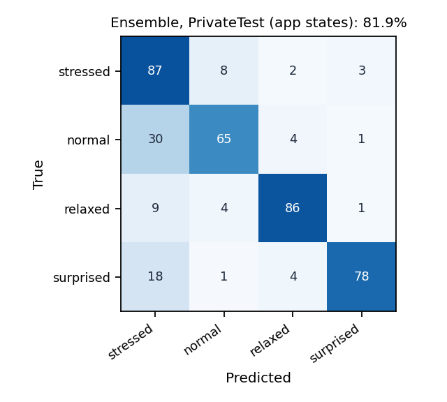
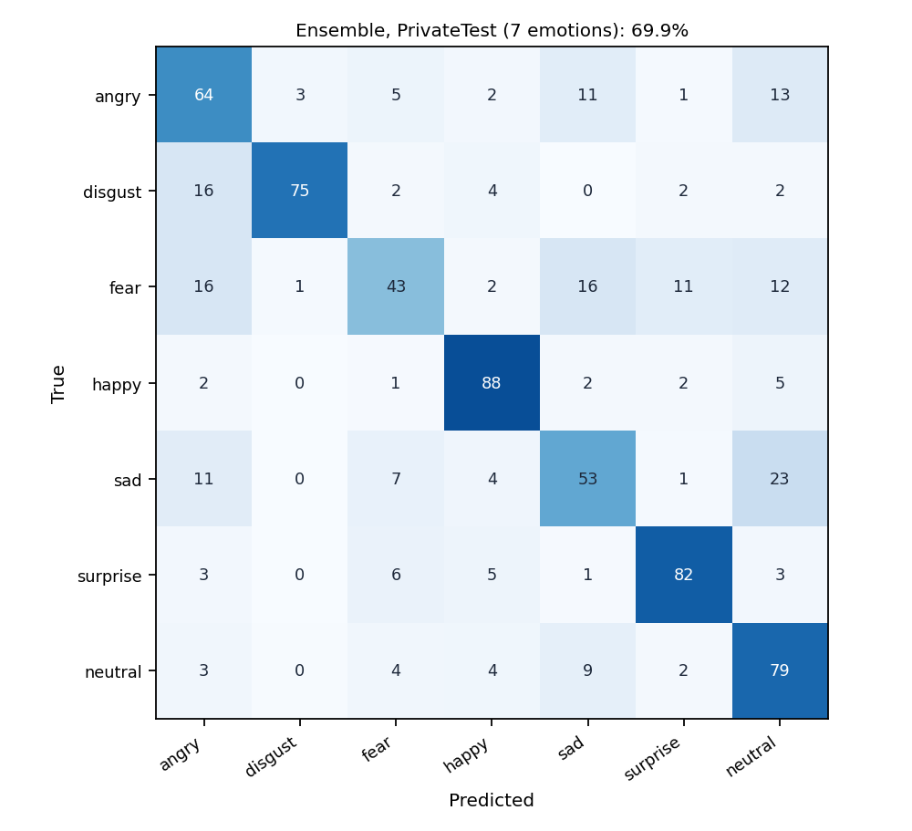

# Emotion model results (generated by evaluate.py)

All numbers are on FER-2013 **PrivateTest** (3,589 faces), which was not used for training, checkpoint selection or ensemble selection.

Shipped ensemble: resnet18 (weight 0.5), vggish (weight 0.5); chosen on PublicTest (81.19% app-state accuracy there).

| Model | Params | App states (4) | 7 emotions | State macro-F1 | Emotion macro-F1 |
|---|---|---|---|---|---|
| resnet18 | 11.2M | 80.30% | 68.63% | 0.784 | 0.669 |
| mobilenetv3 | 4.2M | 76.93% | 63.33% | 0.747 | 0.610 |
| vggish | 1.2M | 80.89% | 67.96% | 0.789 | 0.645 |
| **Ensemble (shipped)** | 12.4M | 81.89% | 69.85% | 0.801 | 0.675 |

Per-state recall (ensemble): stressed 87.2%, normal 65.2%, relaxed 85.7%, surprised 77.9%

Per-emotion recall (ensemble): angry 64.4%, disgust 74.5%, fear 42.6%, happy 88.3%, sad 52.9%, surprise 82.5%, neutral 78.6%

 
